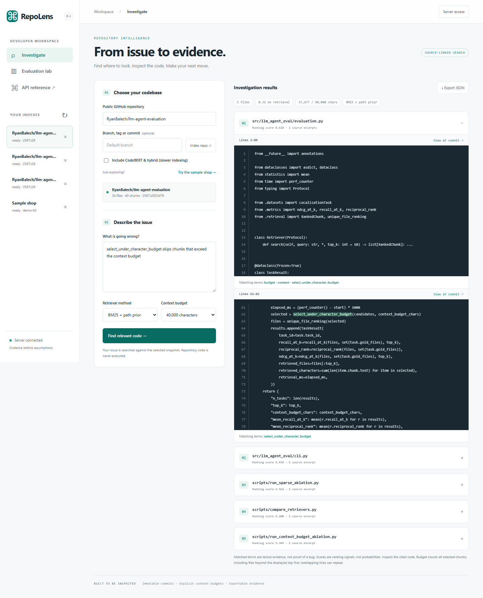

# RepoLens — from issue to evidence

A working developer tool for finding the code behind an issue, backed by a repository-level
retrieval evaluation framework. Index a public GitHub repository, describe a problem, inspect
ranked source excerpts at an immutable commit, and export your investigation.



## Run the application

Python 3.10+ and Git are required. From this checkout:

```powershell
python -m venv .venv
.venv\Scripts\Activate.ps1
python -m pip install -e ".[app,dev]"
repolens
```

On macOS/Linux, activate with `source .venv/bin/activate`. Open **http://127.0.0.1:8000**.
Click **Try the sample shop**, then **Find relevant code** for an offline demonstration.
Or enter a public GitHub repository and click **Index repo**. No paid API key is required.

The app includes background indexing, SQLite job persistence, saved source snapshots,
BM25 search, context budgets, line-numbered code, commit-pinned GitHub links, matched-term
evidence, JSON export, and an evaluation view backed by the archived benchmark artifact.
Optional CodeBERT and hybrid search are enabled with `pip install -e ".[app,ml]"` and
`REPOLENS_ENABLE_DENSE=1` before launch. In PowerShell: `$env:REPOLENS_ENABLE_DENSE="1"`.
Then check **Include CodeBERT & hybrid** when indexing a repository.

For source-cited local explanations, install `.[app,ml]`, set
`REPOLENS_ENABLE_EXPLANATIONS=1`, and restart. Qwen2.5-Coder runs locally with no inference API.
Generated diagnoses remain hypotheses; source excerpts and locations come from the retrieved snapshot.

**Start here:** [Product guide and deployment](docs/PRODUCT.md) ·
[Architecture and tradeoffs](docs/ARCHITECTURE.md) ·
[Local verification record](docs/VERIFICATION.md).

Live static demo: [ryanbalech.github.io/llm-agent-evaluation](https://ryanbalech.github.io/llm-agent-evaluation/).
It runs the shared BM25 engine in the browser against prepared source snapshots. The Python app
supports arbitrary public GitHub indexing and optional CodeBERT/hybrid retrieval.

Coding tools can use the same retrieval service through a local MCP server. It snapshots the
configured workspace, including current edits, or a public GitHub repository; then exposes
index status, issue search, and bounded source inspection as tools. Install `.[mcp]` and see
[MCP setup and tool workflow](docs/MCP.md). The public Pages demo does not host an MCP endpoint.

This release localizes code. Generated fixes and execution of repository code are outside
its implemented workflow. The completed 20-task dense/hybrid study does not show an accuracy
improvement; the balanced 50-task comparison is an optional unfinished extension. The server
supports local or authenticated single-user deployment, with
one process per data directory. A static browser build supports prepared repositories, Python BM25
in WebAssembly, and optional WebGPU explanations without a paid hosting account.

The retrieval engine ranks existing source excerpts. Optional local model generation describes
those excerpts and suggests what to inspect next; citations point to the retrieved snapshot.
A complete coding agent would also edit code and verify a patch against tests. RepoLens does not
perform those steps, and a plausible explanation is not proof that it found the cause.

## Evaluation framework

A file-localization benchmark for the retrieval stage of software-engineering agents.
Given an issue and its repository at the issue's base commit, rank candidate source
files under a fixed code-context budget. Reference patches supply scoring labels only.

## Measured retrieval results

On a fixed **20-task SWE-bench Verified slice**, all three methods completed the same 20 tasks at
the same base commits, with a 40,000-character budget and five distinct output files:

| Method | Recall@5 | MRR | nDCG@5 | Mean query latency |
|---|---:|---:|---:|---:|
| BM25 + filename/path prior | **0.425** | **0.279** | **0.297** | 652 ms |
| CodeBERT mean pooling | 0.000 | 0.000 | 0.000 | 104 ms |
| Hybrid reciprocal-rank fusion | 0.300 | 0.163 | 0.183 | 732 ms |

The paired task-bootstrap 95% interval for CodeBERT minus BM25 Recall@5 is
**[−0.650, −0.225]**; for hybrid minus BM25 it is **[−0.325, 0.050]**. CodeBERT
underperformed in this setup. The hybrid interval includes zero, so this sample does not
establish a difference in Recall@5. Query latency excludes source acquisition and indexing.
Dense index construction averaged 425 seconds on 15 cache misses and 6.9 seconds on five cache
hits; these local timings are not a serving-load benchmark.

The existing baseline includes a path-match weight of 0.15; it is not unmodified
BM25. Gold-label verification finds eight complete top-five localizations, one
partial localization and eleven misses. Twelve of the twenty tasks are from Django.
These are localization scores, not resolved-issue or patch-correctness scores.

[Results, confidence intervals and failure cases](docs/RETRIEVAL_STUDY.md) ·
[Complete 20-task comparison](results/published/verified_20_report.json) ·
[Raw baseline](results/published/swebench_verified_bm25_20.json) ·
[Label-checked analysis](results/published/bm25_error_analysis.json) ·
[Design decisions](docs/METHOD.md)

The completed paired sparse ablation finds Recall@5 of 0.200, 0.275, 0.375,
0.425 and 0.425 at 5k, 10k, 20k, 40k and 80k code characters. Plain BM25 matches
the path-prior baseline on this slice; doubling 40k to 80k adds no top-five recall.
[All seven arms and per-task scores](results/published/sparse_ablation.json).

On a separately frozen **50-task slice across 12 repositories**, excluding the original twenty
and smoke tasks, BM25 completed 50/50 with Recall@5 **0.555**, MRR **0.441**, and nDCG@5 **0.443**.
This repository-balanced sample has a different composition; the difference from the original
baseline is not a method improvement. [Raw results](results/published/verified_balanced_50_bm25.json)
and [frozen manifest](configs/verified_balanced_50_manifest.json) include task-level provenance.
One balanced task includes `setup.cfg` among its gold files. The source-only index excludes that
configuration file, so perfect recall is unavailable on that task; the raw result records it as
an unindexed gold file.

## Implemented methods

- BM25 with configurable filename/path prior and a no-issue file-order control.
- Transformer dense retrieval: attention-masked mean pooling, L2 normalization and cosine ranking.
- Sparse/dense reciprocal-rank fusion through one shared implementation.
- Distinct-file Recall@K, MRR and nDCG; whole-chunk packing under a character budget.
- Paired comparisons that reject mismatched budgets, task lists and incomplete runs.

Dense inference and cache reuse have been checked with the real CodeBERT encoder. The
20-task comparison is complete. The balanced 50-task BM25 arm is complete; its dense/hybrid
comparison was stopped after 19 dense tasks, with its checkpoint preserved. It is not used for
an accuracy comparison or required to run RepoLens.
The benchmark loads one encoder per run, reuses content-addressed
embeddings, records resolved encoder revisions and writes an atomic checkpoint per task.

## Run

Python 3.10+. The basic lexical benchmark has no ML dependencies.

```bash
python -m pip install -e ".[dev,bench]"
python scripts/materialize_verified_slice.py --output .benchmark/study.jsonl --limit 20 --exclude-smoke
python -m llm_agent_eval.cli swebench --tasks .benchmark/study.jsonl \
  --output results/bm25.json --method bm25
python scripts/run_sparse_ablation.py .benchmark/study.jsonl
python scripts/analyze_localization.py results/bm25.json .benchmark/study.jsonl
python -m pytest -q
```

The materializer resolves a dataset branch to an immutable Hugging Face commit.
The frozen [20-task audit manifest](configs/verified_20_manifest.json) includes base
commits and issue/patch hashes. Dense/hybrid runs need `.[ml]`; the comparison workflow
pins CodeBERT weights and shares an embedding cache between methods.

For the measured local stack, see [requirements-reproduce.txt](requirements-reproduce.txt)
(Python 3.12; critical package pins).

## Code

- [benchmark.py](src/llm_agent_eval/benchmark.py): base-commit checkouts, manifest, progress and failures.
- [retrieval.py](src/llm_agent_eval/retrieval.py), [dense.py](src/llm_agent_eval/dense.py), [hybrid.py](src/llm_agent_eval/hybrid.py): ranking methods.
- [evaluation.py](src/llm_agent_eval/evaluation.py): context packing and file-level scoring.
- [comparison.py](src/llm_agent_eval/comparison.py): strict paired-artifact validation.

LLM reranking/provider interfaces are additional plumbing. Patch generation and an
iterative coding-agent loop are future work, not demonstrated capabilities.

## References

[SWE-bench retrieval guide](https://www.swebench.com/SWE-bench/guides/create_rag_datasets/)
and [mini-swe-agent](https://github.com/SWE-agent/mini-swe-agent) provide benchmark and
agent context; this repository isolates retrieval instead of reproducing their agent scores.
