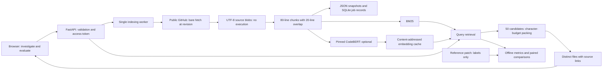

# Architecture and engineering decisions

## Why these choices

**One retrieval engine for experiments and the product.** The API wraps the existing retrievers
and budget selector. This reduces the risk of a polished demo behaving like a different system
from the evaluated code. One deliberate difference is that the product suppresses BM25 results
with no lexical evidence. Demo and benchmark semantics are documented separately.

**FastAPI and a same-origin browser client.** An API makes the retrieval engine reusable and
gives a typed request schema, validation, and generated documentation. The browser needs only
repository forms, polling, and inspectable results; plain JavaScript and CSS keep it distributable
as one Python package and one container. React is a reasonable later choice if interaction state
becomes more complex.

**Bare Git fetch and blob reading.** Repository ingestion does not check out files, run package
installation, initialize submodules, or execute code. Only public GitHub HTTPS URLs are accepted.
Git configuration and credentials are isolated from the service. Source links use the resolved
commit, not a branch name that may move. Fetching still needs operational disk limits.

**SQLite metadata and JSON snapshots.** This is enough for a single-user application with twenty
indexes. Atomic snapshot replacement precedes the ready state. On restart, completed indexes
load from disk and incomplete jobs become failed. A PostgreSQL database and external job queue
would become appropriate with multiple server instances, tenant ownership, and durable retries.

**Bounded concurrency and caching.** One worker bounds indexing concurrency; three outstanding
jobs bound the queue; three retrieval indexes remain in memory. Dense inference shares one
encoder and is serialized. Repeated immutable inputs reuse content-addressed embeddings.
The design favors a predictable demo over high-throughput multi-tenant service.

**Grounded evidence.** A result contains actual code, line numbers, matched terms, and its source
revision. BM25 and cosine scores are not calibrated confidence. Optional local explanations cite
known retrieved excerpts. Source text and locations are attached from the immutable snapshot;
model-supplied quotes and links are ignored. Valid citations do not verify the model's diagnosis.

**Static deployment without a serving bill.** Prepared public source snapshots and the Python
lexical engine run in a Pyodide Web Worker on GitHub Pages. The browser adapter is checked against
the server for ranking, context packing, and source evidence. A separate optional WebLLM worker
runtime performs local GPU inference with quantized pinned weights. The server supports arbitrary
repository ingestion and optional dense search; the static deployment intentionally has no such
server endpoints. Search queries are not sent to an inference provider. Runtime and model assets
are downloaded from versioned public CDNs and model repositories.

## What the evaluation measures

File Recall@5, reciprocal rank, and nDCG@5 compare the file ranking with files changed by the
reference patch. Changed files are useful proxy labels, but the set of useful debugging context
may include additional files. High localization scores do not establish patch correctness.

The archived 20-task slice includes twelve Django tasks. Paired bootstrap intervals account for
pairing by task, not repository-level dependence. Future work should freeze a separate test set,
report repository composition, and use repository-aware uncertainty analysis where appropriate.
The full dense/hybrid comparison remains unfinished. CodeBERT mean pooling without retrieval
fine-tuning is an experimental baseline; it has no guaranteed semantic retrieval advantage.

## Design constraints

1. Character budgets approximate context size; a target model tokenizer would be more accurate.
2. Line chunks may truncate functions, overlap, and exceed the encoder's 512-token window.
3. File ranking uses first appearance among selected chunks; large files can dominate candidates.
4. Lexical tokenization preserves underscores and does not split camelCase identifiers.
5. Retrieval scans each chunk. An inverted index or vector ANN index is not yet necessary at the
   supported scale, but would matter at larger scale. Measure before changing the storage model.
6. A shared token grants access to every index. Tenant ownership and quotas must precede
   multi-user deployment; an external identity provider alone would not solve authorization.
7. Indexing limits do not cap the Git pack transfer. Isolated job processes, disk quotas, cancellation,
   and egress controls belong in a public service deployment.
